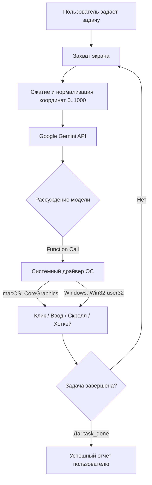

<div align="center">

# 🤖 Computer Use for Gemini

**Автономный агент управления компьютером на базе Google Gemini Vision API**  
*Полноценная поддержка macOS (Apple Silicon / Intel) и Windows 10 / 11*

[](https://python.org)
[](https://aistudio.google.com)
[](https://apple.com)
[](https://microsoft.com)
[](LICENSE)

[Возможности](#-возможности) • [Архитектура](#-архитектура) • [Быстрый старт](#-быстрый-старт) • [Запуск в IDE](#-запуск-прямо-в-ide) • [API-ключ](#-настройка-api-ключа) • [Инструменты](#-поддерживаемые-действия-модели) • [Безопасность](#️-безопасность) • [FAQ](#-решение-частых-проблем)

</div>

---

## 📖 О проекте

**Computer Use for Gemini** — это открытая альтернатива агентного управления операционной системой через официальный **Google Gemini API**. 

Агент «глазами» Gemini анализирует экран в реальном времени, планирует последовательность действий и физически управляет вашей мышью и клавиатурой через нативные системные вызовы ОС — открывает программы, кликает по кнопкам, заполняет формы, работает с браузером и решает любые повседневные задачи.

---

## ✨ Возможности

- 🖱️ **Плавное и реалистичное управление мышью**:
  - Естественные перемещения курсора со сглаживанием (косинусное замедление / easing)
  - Одиночные, двойные и правые клики
  - Перетаскивание объектов (Drag & Drop)
  - Скроллинг колесиком вверх/вниз
- ⌨️ **Умный ввод текста и горячие клавиши**:
  - **Unicode-печать**: корректный ввод русского и английского текста, спецсимволов и эмодзи независимо от активной системной раскладки клавиатуры.
  - Поддержка системных шорткатов: Spotlight (`Cmd+Space`), поиск Windows (`Win+S`), диалог «Выполнить» (`Win+R`), `Ctrl/Cmd+C`, `Ctrl/Cmd+V`, `Ctrl/Cmd+T`, `Ctrl/Cmd+W`, `Alt+Tab`, `Alt+F4` и др.
- 🎯 **Высокоточная визуальная координатная сетка**:
  - Нормализованная система координат `0..1000` — Gemini безошибочно попадает в мелкие кнопки, чекбоксы и поля ввода.
  - Автоматическая поддержка **Retina (2.0x)** на Mac и **Per-Monitor DPI Scaling** (125%, 150%, 200%) на Windows.
- 🚀 **Zero Dependencies (Работа из коробки)**:
  - **macOS**: работает на нативном `CoreGraphics` и системных утилитах `screencapture`/`sips`.
  - **Windows**: работает на нативном `user32.dll` через `ctypes` и встроенном PowerShell.
- 🛡️ **Аварийный предохранитель (Emergency Failsafe)**:
  - Если агент начал делать что-то не то — **просто резко уведите мышь в любой угол экрана**, и скрипт мгновенно остановится.
- 🔄 **Автоматическая отказоустойчивость (Auto-Fallback & Retry)**:
  - При возникновении пиковых перегрузок серверов (`HTTP 503 / 429`) скрипт не вылетает, а автоматически повторяет попытку и при необходимости переключается на резервные доступные модели (`gemini-3.5-flash`, `gemini-3.8-flash`, `gemini-3-flash-preview`, `gemini-flash-latest`).
- 💻 **Дружелюбен к IDE**:
  - Работает даже в режиме Read-Only (вкладка Output в VS Code / Cursor) благодаря встроенной переменной `TASK` в коде и всплывающим окнам ввода.

---

## 🏗 Архитектура



---

## 🚀 Быстрый старт

### 🍏 macOS

#### Шаг 1. Скачайте проект
Скачайте архив `gemini_computer_use(macOS).zip` из репозитория и распакуйте его, либо клонируйте репозиторий.

#### Шаг 2. Перейдите в папку проекта в Терминале
```bash
cd gemini_computer_use
```

#### Шаг 3. Проверьте системные разрешения macOS
Для эмуляции мыши и снятия скриншотов macOS требует выдать терминалу два разрешения:

```bash
python3 check_permissions.py
```

Скрипт проверит:
- **Универсальный доступ (Accessibility)** — управление курсором и клавиатурой.
- **Запись экрана (Screen Recording)** — чтение картинки с монитора.

> 💡 *Если разрешение выключено, скрипт сам предложит открыть нужный раздел «Системных настроек».*

#### Шаг 4. Запустите выполнение
```bash
# Автономный запуск задачи:
python3 run.py "Открой Safari и найди курс доллара к рублю"

# Запуск с подтверждением каждого клика:
python3 run.py --confirm "Открой Калькулятор и сосчитай 125 * 48"

# Интерактивный запуск (ввод задачи в диалоге):
python3 run.py
```

---

### 🪟 Windows

#### Шаг 1. Скачайте проект
Скачайте архив `gemini_computer_use_windows.zip` из репозитория и распакуйте его в удобную папку.

#### Шаг 2. Запуск в 1 клик (без командной строки)
1. Дважды кликните по файлу `run.bat`.
2. На экране появится удобное графическое окно: введите туда задачу (например: *«Открой Chrome и найди курс доллара»*) и нажмите **Запустить**.

#### Шаг 3. Запуск через командную строку (CMD / PowerShell)
```cmd
python run.py "Открой Блокнот и напиши список дел: купить молоко, хлеб, сыр"
```

> 💡 *(Опционально)*: Для максимальной скорости снимков экрана на Windows запустите `install.bat` (установит компактную библиотеку `Pillow`). Если её не ставить, скрипт автоматически использует встроенный в Windows PowerShell.

---

## 💻 Запуск прямо в IDE

Если при нажатии кнопки **Run / Play** в вашей IDE (VS Code, Cursor, PyCharm) консоль пишет `read-only` (запуск через вкладку *Output* или расширение *Code Runner*):

### Способ 1: Укажите задачу прямо в файле `run.py`
Откройте файл `run.py` в IDE и впишите вашу задачу в строку `TASK` в самом верху:

```python
# 🎯 НАСТРОЙКИ ЗАДАЧИ
TASK = "Открой браузер, перейди на youtube.com и найди lofi hip hop"

# 🤖 МОДЕЛЬ (gemini-3.5-flash / gemini-3.8-flash)
GEMINI_MODEL = "gemini-3.5-flash"

# 🤝 ПОДТВЕРЖДЕНИЕ ШАГОВ (False = полностью автономно, True = подтверждать каждый шаг)
CONFIRM_EACH_STEP = False
```
Нажмите **Run (Play)** — агент сразу начнет выполнение без ожидания ввода с клавиатуры!

### Способ 2: Всплывающее окно
Если оставить `TASK = ""` пустым, скрипт автоматически покажет всплывающее окно поверх всех окон для ввода задачи.

---

## 🔑 Настройка API-ключа

Для работы используется бесплатный API-ключ от Google AI Studio:

1. Получите ключ на [aistudio.google.com/app/apikey](https://aistudio.google.com/app/apikey) (занимает 1 минуту).
2. Выберите удобный способ указания:

**Вариант А. Прямо в файле `run.py`:**
```python
GEMINI_API_KEY = "AIzaSyВашКлюч"
```

**Вариант Б. Через файл `.env` в папке проекта:**
```env
GEMINI_API_KEY="AIzaSyВашКлюч"
GEMINI_MODEL="gemini-3.5-flash"
```

**Вариант В. Через переменные окружения:**
```bash
# macOS / Linux:
export GEMINI_API_KEY="AIzaSyВашКлюч"

# Windows CMD:
set GEMINI_API_KEY=AIzaSyВашКлюч

# Windows PowerShell:
$env:GEMINI_API_KEY="AIzaSyВашКлюч"
```

---

## 🛠 Поддерживаемые действия модели

Gemini использует встроенный механизм **Function Calling**, вызывая следующие инструменты:

| Инструмент | Параметры | Описание |
| :--- | :--- | :--- |
| `mouse_click` | `x`, `y`, `button`, `clicks` | Клик мыши по нормализованным координатам (`0–1000`). Поддерживает левый/правый клик и дабл-клик. |
| `mouse_move` | `x`, `y` | Плавное наведение курсора мыши на элемент. |
| `mouse_drag` | `start_x`, `start_y`, `end_x`, `end_y` | Зажатие левой кнопки и перетаскивание в целевую точку. |
| `mouse_scroll` | `direction`, `amount` | Скроллинг колесиком мыши (`up` или `down`). |
| `type_text` | `text`, `press_enter` | Ввод текста в активное поле с возможностью автоматического нажатия `Enter`. |
| `press_key` | `key` | Нажатие клавиш (`enter`, `tab`, `escape`, `space`, `backspace`, `win`, стрелки). |
| `hotkey` | `keys` | Нажатие комбинаций клавиш: `["command", "space"]`, `["win", "s"]`, `["ctrl", "c"]`, `["ctrl", "v"]` и др. |
| `wait` | `seconds` | Пауза для ожидания загрузки страницы или открытия окна. |
| `task_done` | `summary` | Сигнал об успешном завершении задачи с кратким итоговым отчетом. |
| `task_failed` | `reason` | Сигнал о невозможности продолжить при критической ошибке. |

---

## 🛡️ Безопасность

- 🚨 **Corner Failsafe (Угловой предохранитель)**: Если модель пошла не по тому сценарию, просто резко уведите физическую мышь в любой из 4-х углов экрана. Скрипт мгновенно прекратит выполнение.
- 🤝 **Режим подтверждения (`--confirm`)**: Запустите `run.py --confirm` — перед каждым кликом и нажатием клавиши агент будет спрашивать разрешение в консоли.
- ⏱️ **Лимит шагов (`MAX_STEPS`)**: Защита от бесконечных циклов (по умолчанию ограничение — 25 действий).
- 🛑 **Прерывание из терминала**: Стандартное сочетание `Ctrl + C` мгновенно останавливает процесс.

---

## ❓ Решение частых проблем

<details>
<summary><b>1. Ошибка 503: «This model is currently experiencing high demand»</b></summary>
<br>

- **Причина**: Временная пиковая перегрузка серверов Google на определенной модели.
- **Решение**: В проект уже встроен Auto-Fallback — агент сам переключается между моделями `gemini-3.5-flash`, `gemini-3.8-flash` и `gemini-flash-latest`. Рекомендуется использовать модель `gemini-3.5-flash`, которая работает стабильно и без очередей.
</details>

<details>
<summary><b>2. Консоль в VS Code / Cursor пишет: «Cannot edit in read-only editor»</b></summary>
<br>

- **Причина**: Кнопка *Run* запускает код через вкладку *Output* вместо интерактивного терминала.
- **Решение**: Либо впишите задачу прямо в `TASK = "..."` в файле `run.py`, либо внизу окна IDE переключитесь на вкладку **Terminal** и запустите команду:
  ```bash
  python3 run.py "ваша задача"
  ```
</details>

<details>
<summary><b>3. На Mac курсор не двигается или скриншот пустой</b></summary>
<br>

- **Решение**: Откройте **Системные настройки ➔ Конфиденциальность и безопасность**:
  1. В разделе **Универсальный доступ** включите переключатель для вашего Терминала / VS Code.
  2. В разделе **Запись экрана** включите переключатель для вашего Терминала / VS Code.
</details>

---

## 📂 Исходный код и лицензия

Все модули автономны и написаны на чистом Python.  
Проект распространяется под открытой лицензией [MIT](LICENSE).
