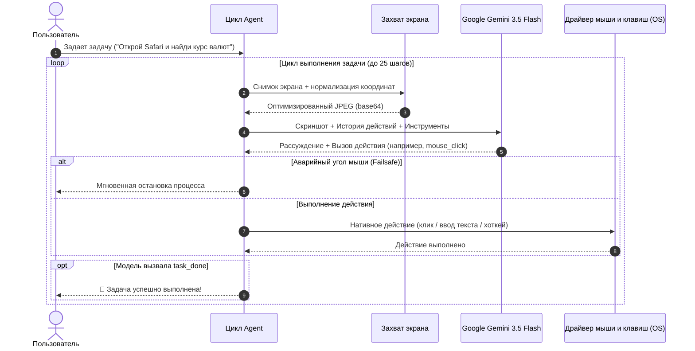

<div align="center">

# 🤖 Computer Use for Gemini

**Автономная система управления компьютером через официальный Google Gemini Vision API**  
*Работает на macOS (Apple Silicon / Intel) и Windows 10 / 11*

[](https://python.org)
[](https://aistudio.google.com)
[](https://apple.com)
[](https://microsoft.com)
[-brightgreen?style=for-the-badge)](https://github.com)
[](LICENSE)

</div>

---

## 📑 Оглавление

1. [О проекте](#-о-проекте)
2. [Ключевые возможности](#-ключевые-возможности)
3. [Архитектура работы](#-архитектура-работы)
4. [Быстрый старт: macOS](#-быстрый-старт-macos)
5. [Быстрый старт: Windows](#-быстрый-старт-windows)
6. [Запуск прямо в IDE (VS Code, Cursor, PyCharm)](#-запуск-прямо-в-ide)
7. [Настройка API-ключа](#-настройка-api-ключа)
8. [Поддерживаемые действия модели (Tools)](#-поддерживаемые-действия-модели)
9. [Безопасность и аварийная остановка](#-безопасность-и-аварийная-остановка)
10. [Решение частых проблем (FAQ / Troubleshooting)](#-решение-частых-проблем)
11. [Полный исходный код модулей](#-исходный-код-модулей)

---

## 📖 О проекте

**Computer Use for Gemini** — это полноценная открытая реализация OS Agent (Computer Use) для моделей **Google Gemini** (`gemini-3.5-flash`, `gemini-3.8-flash`, `gemini-flash-latest`). 

Агент в цикле делает скриншоты вашего экрана, анализирует интерфейс с помощью мультимодального зрения Gemini, планирует шаги и физически управляет мышью и клавиатурой через нативные системные вызовы:
- В **macOS** — через нативный фреймворк `CoreGraphics` и системные утилиты `screencapture`/`sips`.
- В **Windows** — через нативный Win32 API (`user32.dll`) и вызовы `SendInput` с прямой поддержкой Unicode.

> **Zero Dependencies**: Проект не требует установки тяжелых библиотек вроде PyAutoGUI или Quartz. Всё работает на чистом Python 3 из коробки!

---

## ✨ Ключевые возможности

| Функция | Описание |
|---|---|
| 🖱️ **Плавная мышь** | Перемещение курсора со сглаживанием (косинусное замедление / easing), клики (левый, правый, двойной), перетаскивание (Drag & Drop), скроллинг. |
| ⌨️ **Unicode-печать** | Ввод любого текста (русский, английский, символы, эмодзи) без сбоев раскладки. |
| ⚡ **Горячие клавиши** | macOS: Spotlight (`Cmd+Space`), `Cmd+C`, `Cmd+V`, `Cmd+T`, `Cmd+W`.<br>Windows: Поиск (`Win+S`), `Win+R`, `Ctrl+C`, `Ctrl+V`, `Alt+Tab`, `Alt+F4`. |
| 🎯 **Сетка 0..1000** | Нормализованная система координат для попадания в любые мелкие кнопки. |
| 🖥️ **Масштабирование экранов** | Автоматическая поддержка **Retina (2.0x)** на Mac и **DPI Scaling** (125%, 150%, 200%) на Windows. |
| 🛡️ **Corner Failsafe** | Экстренная остановка: резкий сдвиг мыши в любой угол экрана мгновенно прерывает выполнение. |
| 🔄 **Auto-Fallback моделей** | При перегрузке серверов (`503 / 429`) скрипт сам переключается на доступные альтернативы (`gemini-3.5-flash`, `gemini-3.8-flash`, `gemini-flash-latest`). |
| 💻 **IDE Friendly** | Работает даже при запуске через вкладку `Output` (Read-Only) благодаря настройке задачи прямо в коде и всплывающим окнам. |

---

## 🏗 Архитектура работы



---

## 🍏 Быстрый старт: macOS

### Шаг 1. Скачайте проект
Скачайте архив [`gemini_computer_use(macOS).zip`](./gemini_computer_use(macOS).zip) из репозитория и распакуйте его, либо клонируйте репозиторий.

### Шаг 2. Перейдите в папку проекта в Терминале
```bash
cd gemini_computer_use
```

### Шаг 3. Проверьте системные разрешения macOS
Для эмуляции мыши и снятия скриншотов macOS требует выдать терминалу два разрешения:
```bash
python3 check_permissions.py
```
Скрипт проверит:
- **Универсальный доступ (Accessibility)** — управление курсором и клавиатурой.
- **Запись экрана (Screen Recording)** — чтение картинки с монитора.
- Если разрешение выключено, скрипт сам предложит открыть нужный раздел «Системных настроек».

### Шаг 4. Запустите выполнение
```bash
# Автономный запуск задачи:
python3 run.py "Открой Safari и найди курс доллара к рублю"

# Запуск с подтверждением каждого клика:
python3 run.py --confirm "Открой Калькулятор и сосчитай 125 * 48"

# Интерактивный запуск (ввод задачи в диалоге):
python3 run.py
```

---

## 🪟 Быстрый старт: Windows

### Шаг 1. Скачайте проект
Скачайте архив [`gemini_computer_use_windows.zip`](./gemini_computer_use_windows.zip) из репозитория и распакуйте его в удобную папку.

### Шаг 2. Запуск в 1 клик (без командной строки)
1. Дважды кликните по файлу **`run.bat`**.
2. На экране появится удобное графическое окно: введите туда задачу (например: *«Открой Chrome и найди курс доллара»*) и нажмите **Запустить**.

### Шаг 3. Запуск через командную строку (CMD / PowerShell)
```cmd
python run.py "Открой Блокнот и напиши список дел: купить молоко, хлеб, сыр"
```

*(Опционально)*: Для максимальной скорости снимков экрана на Windows запустите **`install.bat`** (установит компактную библиотеку `Pillow`). Если ее не ставить, скрипт автоматически использует встроенный в Windows PowerShell.

---

## 💻 Запуск прямо в IDE

Если при нажатии кнопки **Run / Play** в вашей IDE (VS Code, Cursor, PyCharm) консоль пишет `read-only` (запуск через вкладку *Output* или расширение *Code Runner*):

### Способ 1: Укажите задачу прямо в файле `run.py`
Откройте файл `run.py` в IDE и впишите вашу задачу в строку `TASK` в самом верху:
```python
# ==============================================================================
# 🎯 НАСТРОЙКИ ЗАДАЧИ
TASK = "Открой браузер, перейди на youtube.com и найди lofi hip hop"

# 🤖 МОДЕЛЬ (gemini-3.5-flash / gemini-3.8-flash)
GEMINI_MODEL = "gemini-3.5-flash"

# 🤝 ПОДТВЕРЖДЕНИЕ ШАГОВ (False = полностью автономно, True = подтверждать каждый шаг)
CONFIRM_EACH_STEP = False
# ==============================================================================
```
Нажмите **Run (Play)** — агент сразу начнет выполнение без ожидания ввода с клавиатуры!

### Способ 2: Всплывающее окно
Если оставить `TASK = ""` пустым, скрипт автоматически покажет всплывающее окно поверх всех окон для ввода задачи.

---

## 🔑 Настройка API-ключа

Для работы используется бесплатный API-ключ от **Google AI Studio**:

1. Получите ключ на [aistudio.google.com/app/apikey](https://aistudio.google.com/app/apikey) (занимает 1 минуту).
2. Выберите удобный способ указания:
   - **Прямо в файле `run.py`**:
     ```python
     GEMINI_API_KEY = "AIzaSyВашКлюч"
     ```
   - **Через файл `.env`** в папке проекта:
     ```env
     GEMINI_API_KEY="AIzaSyВашКлюч"
     GEMINI_MODEL="gemini-3.5-flash"
     ```
   - **Через переменные окружения**:
     ```bash
     # macOS / Linux:
     export GEMINI_API_KEY="AIzaSyВашКлюч"

     # Windows CMD:
     set GEMINI_API_KEY=AIzaSyВашКлюч

     # Windows PowerShell:
     $env:GEMINI_API_KEY="AIzaSyВашКлюч"
     ```

---

## 🛠 Поддерживаемые действия модели

Gemini использует встроенный механизм **Function Calling**, вызывая следующие инструменты:

| Инструмент | Параметры | Описание |
|---|---|---|
| `mouse_click` | `x`, `y`, `button`, `clicks` | Клик мыши по нормализованным координатам (0–1000). Поддерживает левый/правый клик и дабл-клик. |
| `mouse_move` | `x`, `y` | Плавное наведение курсора мыши на элемент. |
| `mouse_drag` | `start_x`, `start_y`, `end_x`, `end_y` | Зажатие левой кнопки и перетаскивание в целевую точку. |
| `mouse_scroll`| `direction`, `amount` | Скроллинг колесиком мыши (`up` или `down`). |
| `type_text` | `text`, `press_enter` | Ввод текста в активное поле с возможностью автоматического нажатия Enter. |
| `press_key` | `key` | Нажатие клавиш (`enter`, `tab`, `escape`, `space`, `backspace`, `win`, стрелки). |
| `hotkey` | `keys` | Нажатие комбинаций клавиш: `["command", "space"]`, `["win", "s"]`, `["ctrl", "c"]`, `["ctrl", "v"]` и др. |
| `wait` | `seconds` | Пауза для ожидания загрузки страницы или открытия окна. |
| `task_done` | `summary` | Сигнал об успешном завершении задачи с кратким итоговым отчетом. |
| `task_failed`| `reason` | Сигнал о невозможности продолжить при критической ошибке. |

---

## 🛡️ Безопасность и аварийная остановка

- 🚨 **Corner Failsafe (Угловой предохранитель)**: Если модель пошла не по тому сценарию, **просто резко уведите физическую мышь в любой из 4-х углов экрана**. Скрипт мгновенно прекратит выполнение.
- 🤝 **Режим подтверждения (`--confirm`)**: Запустите `run.py --confirm` — перед каждым кликом и нажатием клавиши агент будет спрашивать разрешение в консоли.
- ⏱️ **Лимит шагов (`MAX_STEPS`)**: Защита от бесконечных циклов (по умолчанию ограничение — 25 действий).
- 🛑 **Прерывание из терминала**: Стандартное сочетание `Ctrl + C` мгновенно останавливает процесс.

---

## ❓ Решение частых проблем

### 1. Ошибка 503: *«This model is currently experiencing high demand»*
- **Причина**: Временная пиковая перегрузка серверов Google на определенной модели.
- **Решение**: В проект уже встроен **Auto-Fallback** — агент сам переключается между моделями `gemini-3.5-flash`, `gemini-3.8-flash` и `gemini-flash-latest`. Рекомендуется использовать модель `gemini-3.5-flash`, которая работает стабильно и без очередей.

### 2. Консоль в VS Code / Cursor пишет: *«Cannot edit in read-only editor»*
- **Причина**: Кнопка Run запускает код через вкладку *Output* вместо интерактивного терминала.
- **Решение**: Либо впишите задачу прямо в `TASK = "..."` в файле `run.py`, либо внизу окна IDE переключитесь на вкладку **Terminal** и запустите команду `python3 run.py "задача"`.

### 3. На Mac курсор не двигается или скриншот пустой
- **Решение**: Откройте *Системные настройки ➔ Конфиденциальность и безопасность*:
  1. В разделе **Универсальный доступ** включите переключатель для вашего Терминала / VS Code.
  2. В разделе **Запись экрана** включите переключатель для вашего Терминала / VS Code.

---

## 📂 Исходный код модулей

Все модули автономны и написаны на чистом Python:

<details>
<summary><b>📄 Показать код: <code>controller.py</code> (Нативный драйвер macOS CoreGraphics)</b></summary>

```python
import ctypes
import math
import time

cg = ctypes.cdll.LoadLibrary('/System/Library/Frameworks/CoreGraphics.framework/CoreGraphics')

class CGPoint(ctypes.Structure):
    _fields_ = [('x', ctypes.c_double), ('y', ctypes.c_double)]

cg.CGMainDisplayID.restype = ctypes.c_uint32
cg.CGDisplayPixelsWide.restype = ctypes.c_size_t
cg.CGDisplayPixelsWide.argtypes = [ctypes.c_uint32]
cg.CGDisplayPixelsHigh.restype = ctypes.c_size_t
cg.CGDisplayPixelsHigh.argtypes = [ctypes.c_uint32]
cg.CGEventCreate.restype = ctypes.c_void_p
cg.CGEventGetLocation.restype = CGPoint
cg.CGEventGetLocation.argtypes = [ctypes.c_void_p]
cg.CGEventCreateMouseEvent.restype = ctypes.c_void_p
cg.CGEventCreateMouseEvent.argtypes = [ctypes.c_void_p, ctypes.c_uint32, CGPoint, ctypes.c_uint32]
cg.CGEventSetIntegerValueField.restype = None
cg.CGEventSetIntegerValueField.argtypes = [ctypes.c_void_p, ctypes.c_uint32, ctypes.c_int64]
cg.CGEventCreateKeyboardEvent.restype = ctypes.c_void_p
cg.CGEventCreateKeyboardEvent.argtypes = [ctypes.c_void_p, ctypes.c_uint16, ctypes.c_bool]
cg.CGEventKeyboardSetUnicodeString.restype = None
cg.CGEventKeyboardSetUnicodeString.argtypes = [ctypes.c_void_p, ctypes.c_ulong, ctypes.c_wchar_p]
cg.CGEventPost.restype = None
cg.CGEventPost.argtypes = [ctypes.c_uint32, ctypes.c_void_p]

# Плавное перемещение с косинусным замедлением
def move_mouse_smooth(target_x, target_y, duration=0.25, steps=12):
    evt = cg.CGEventCreate(None)
    loc = cg.CGEventGetLocation(evt)
    start_x, start_y = loc.x, loc.y
    for i in range(1, steps + 1):
        t = i / steps
        eased_t = (1.0 - math.cos(t * math.pi)) / 2.0
        cur_x = start_x + (target_x - start_x) * eased_t
        cur_y = start_y + (target_y - start_y) * eased_t
        pt = CGPoint(cur_x, cur_y)
        cg.CGEventPost(0, cg.CGEventCreateMouseEvent(None, 5, pt, 0))
        time.sleep(duration / steps)
```
</details>

<details>
<summary><b>📄 Показать код: <code>controller_windows.py</code> (Нативный драйвер Windows Win32)</b></summary>

```python
import ctypes
from ctypes import wintypes
import math
import time

user32 = ctypes.windll.user32

# Включение DPI-Awareness для точных пиксельных координат
try:
    ctypes.windll.shcore.SetProcessDpiAwareness(2)
except Exception:
    try:
        user32.SetProcessDPIAware()
    except Exception:
        pass

def move_mouse_smooth_win(target_x, target_y, duration=0.25, steps=12):
    pt = wintypes.POINT()
    user32.GetCursorPos(ctypes.byref(pt))
    start_x, start_y = pt.x, pt.y
    for i in range(1, steps + 1):
        t = i / steps
        eased_t = (1.0 - math.cos(t * math.pi)) / 2.0
        cur_x = int(start_x + (target_x - start_x) * eased_t)
        cur_y = int(start_y + (target_y - start_y) * eased_t)
        user32.SetCursorPos(cur_x, cur_y)
        time.sleep(duration / steps)
```
</details>

---

## 📄 Лицензия

Проект распространяется под открытой лицензией **MIT**. Подробности в файле `LICENSE`.
